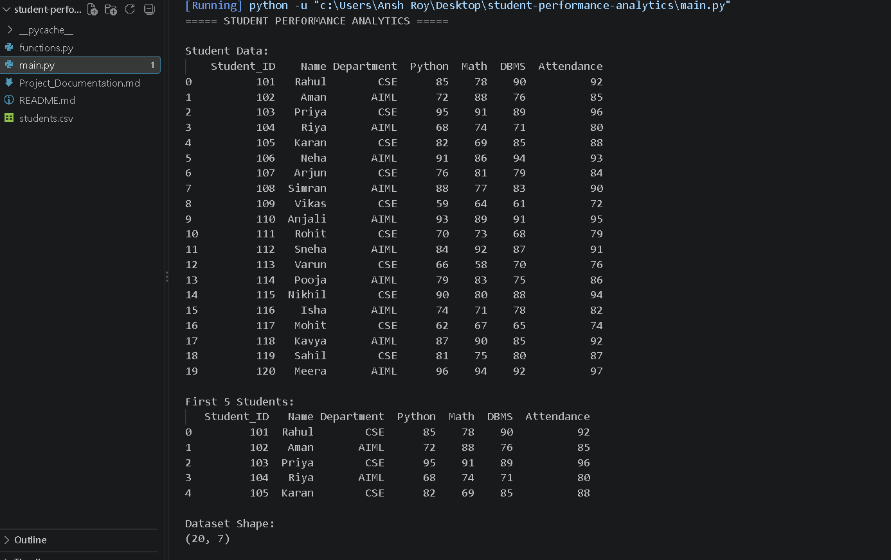
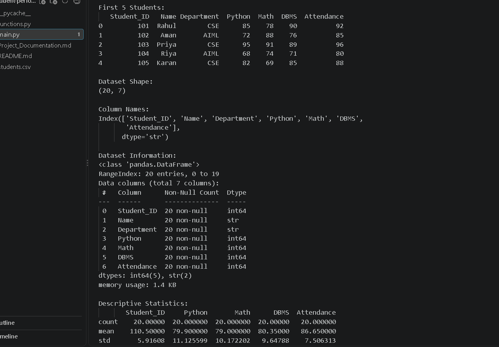
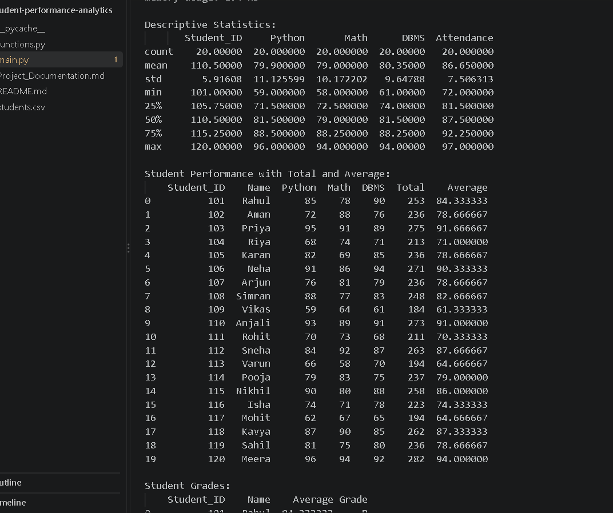
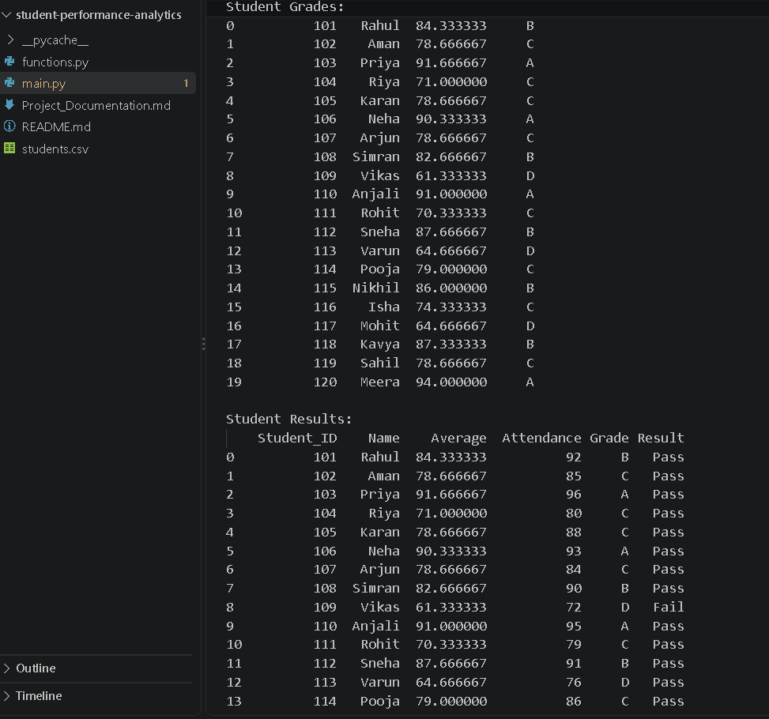
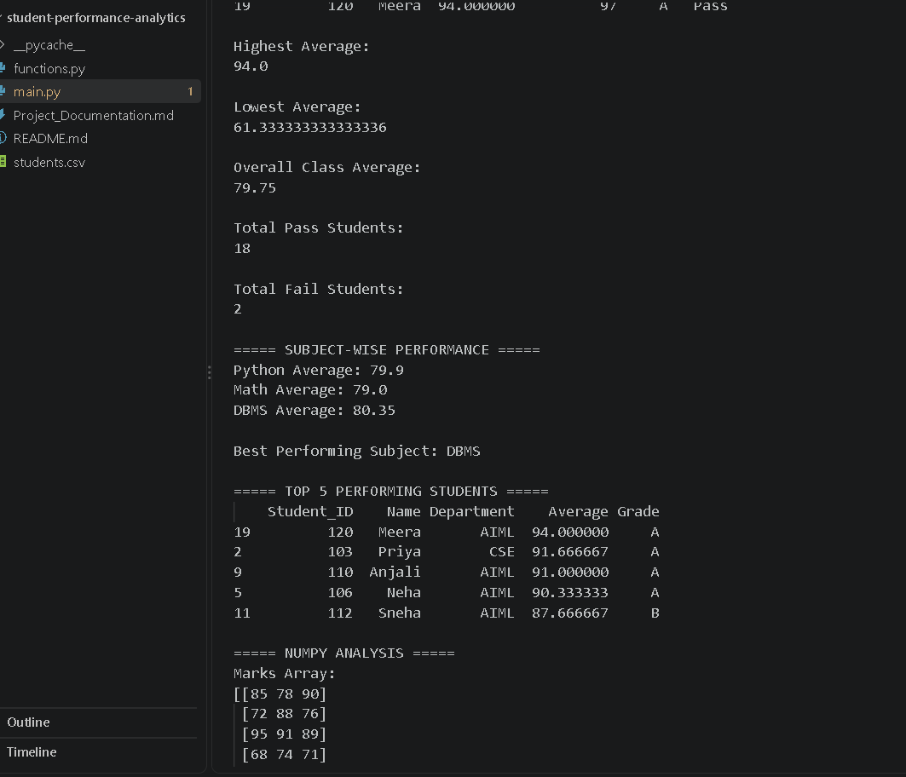
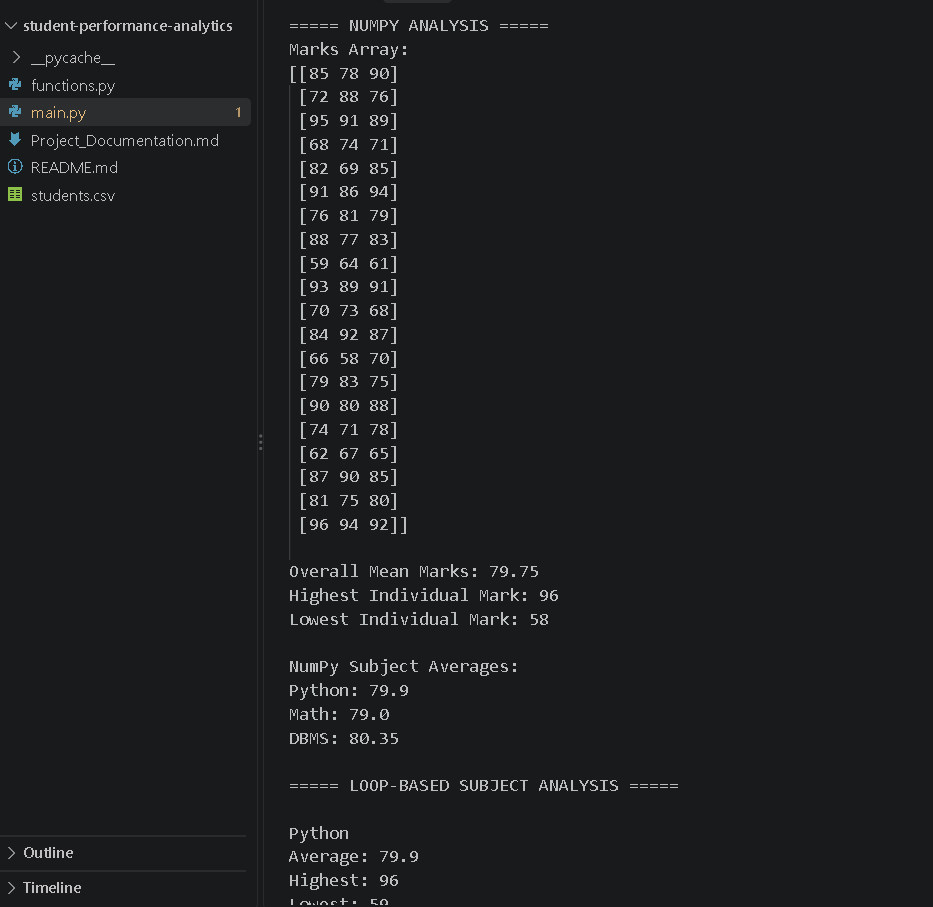
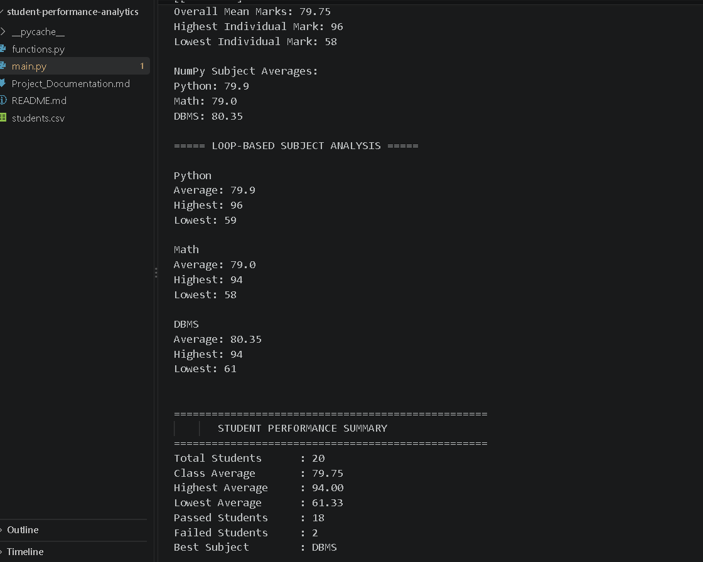
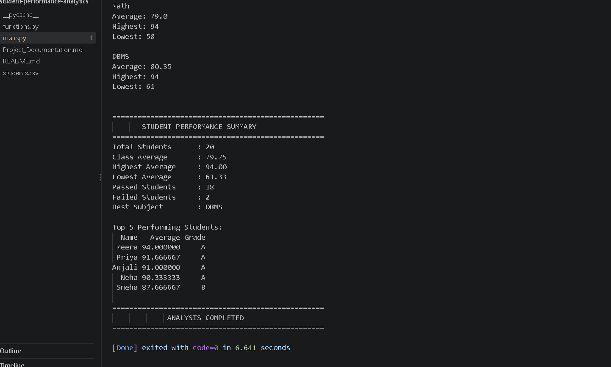

# Student Performance Analytics System

**Technology:** Python, NumPy, Pandas

**Project Type:** Python Project Assignment

## 1. Objective

The objective of this project is to develop a Python-based Student Performance Analytics System.

The system reads student data from a CSV file and uses Pandas and NumPy to analyze student marks and attendance. It calculates total and average marks, assigns grades, determines Pass/Fail status, performs subject-wise analysis, and identifies the top-performing students.

## 2. Technologies Used

- Python
- Pandas
- NumPy
- VS Code
- Git & GitHub

## 3. Dataset Description

The project uses a CSV dataset named `students.csv`.

The dataset contains 20 student records with the following fields:

- Student ID
- Name
- Department
- Python Marks
- Math Marks
- DBMS Marks
- Attendance

The dataset is loaded into a Pandas DataFrame for processing and analysis.

## 4. Implementation

The project is implemented using Python, Pandas, and NumPy.

### 4.1 Data Loading

The `students.csv` file is loaded using Pandas:

```python
df = pd.read_csv("students.csv")
```
### 4.2 Data Analysis

The system calculates:

- Total marks of each student
- Average marks
- Grades
- Pass/Fail status
- Highest and lowest average
- Overall class average

### 4.3 Subject-wise Analysis

The project analyzes Python, Math, and DBMS marks to calculate:

- Average marks
- Highest marks
- Lowest marks
- Best-performing subject

### 4.4 NumPy Analysis

NumPy is used to convert subject marks into a NumPy array and perform numerical calculations such as mean, maximum, minimum, and subject-wise averages.

### 4.5 Functions

Reusable functions are used for:

- Grade calculation
- Pass/Fail checking
- Finding top-performing students

### 4.6 Loops

A loop is used to perform subject-wise analysis for Python, Math, and DBMS.

## 5. Key Features

- CSV-based student data management
- Student marks and attendance analysis
- Total and average marks calculation
- Automatic grade assignment
- Pass/Fail result determination
- Overall class performance analysis
- Subject-wise performance analysis
- Best-performing subject identification
- Top 5 student identification
- NumPy-based numerical analysis
- Reusable Python functions
- Loop-based subject analysis

## 6. Output / Results

After running the program, the following results are generated:

- Student data is displayed successfully.
- Total and average marks are calculated for each student.
- Grades are assigned based on average marks.
- Pass/Fail status is determined using average marks and attendance.
- Highest Average: 94.00
- Lowest Average: 61.33
- Overall Class Average: 79.75
- Total Pass Students: 18
- Total Fail Students: 2
- Best Performing Subject: DBMS
- Top 5 performing students are displayed.
- NumPy analysis successfully calculates overall and subject-wise averages.

## 7. Challenges and Learning

### Challenges

- Understanding how to process CSV data using Pandas
- Working with DataFrame columns and calculations
- Using NumPy arrays for numerical analysis
- Organizing reusable functions in a separate Python file
- Combining Pandas, NumPy, functions, and loops in one project

### Learning Outcomes

Through this project, I learned how to:

- Read and analyze CSV data using Pandas
- Perform numerical calculations using NumPy
- Create and use reusable Python functions
- Use loops for subject-wise analysis
- Calculate student performance metrics
- Organize a Python project into multiple files
- Analyze and interpret student performance data

## 8. Final Outcome

The Student Performance Analytics System successfully analyzes student marks and attendance data.

The project demonstrates the use of Python fundamentals, Pandas, NumPy, functions, and loops to perform meaningful data analysis.

The system successfully generates student performance summaries, grades, Pass/Fail results, subject-wise analysis, and identifies the top-performing students.

### Screenshot 1 - Student Data



### Screenshot 2 - Student Performance



### Screenshot 3 - Student Grades



### Screenshot 4 - Student Results



### Screenshot 5 - Overall Performance



### Screenshot 6 - Subject-wise Performance



### Screenshot 7 - Top Performing Students



### Screenshot 8 - NumPy Analysis

